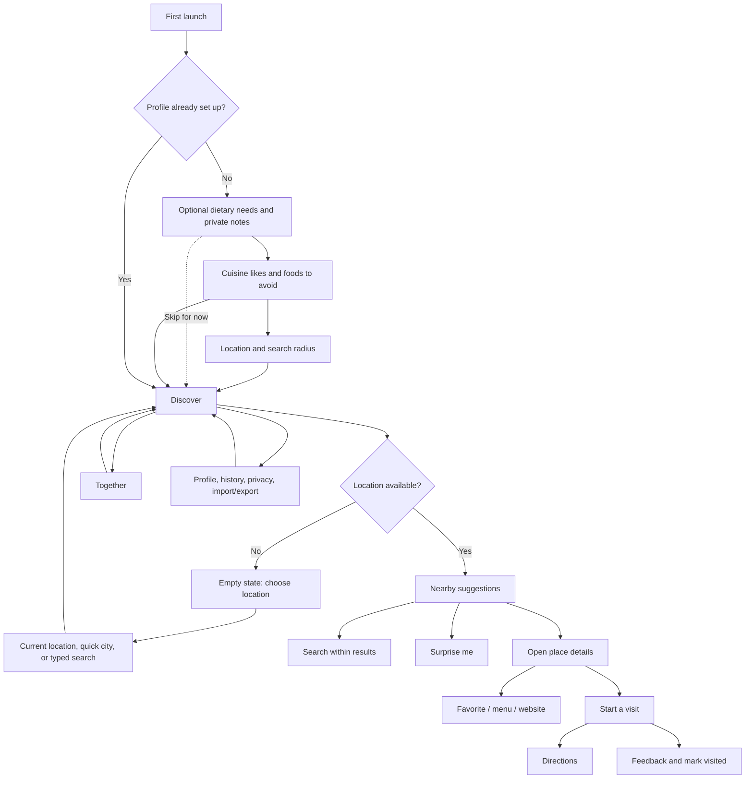
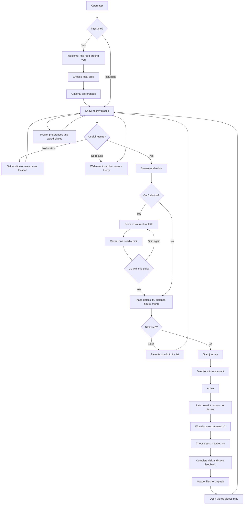

# Lunumi app flow design plan

A flow plan for Lunumi's local discovery and restaurant visit journey. Pass one puts location first, removes Together, adds the roulette reveal, and gives the visit a clear arrival and feedback outro.

## Current app flow before pass one

## Pass one journey

## Flow changes to explore

1. **Start with the local area.** Ask users to choose their area or use current location first, then show nearby places. Preferences follow location setup and remain skippable. Keep food likes optional and dietary needs distinct from allergy safety.
2. **Treat Discover as the home and recovery point.** Show a stable local filter, location, and radius. Keep map directions in a separate tab so the user can return to the open journey.
3. **Make search behavior legible.** The field filters places already loaded nearby. Keep refresh as a separate action so the field does not imply a remote restaurant search.
4. **Make “Surprise me” a character-led roulette.** Lunumi spins a small roulette using the visible, eligible nearby restaurants. After a short pause, the character presents the winning restaurant with an original celebratory reveal inspired by the satisfying reward moment of an adventure game. Show the restaurant name and a clear “Go with this” action, plus “Spin again.” Keep the sequence brief and skippable, respect reduced-motion settings with an instant reveal, and announce the selected restaurant to assistive technology. If there are no eligible places, explain how to widen the radius or refresh.
5. **Explain empty and failure states with a next action.** Distinguish no location, no matches, no nearby data, offline/stale results, and provider failure. Keep location/radius adjustments and retry available in context.
6. **Keep each place decision in one detail view.** Present distance, hours, available menu/site links, and data freshness before the visit action. Label unknown dietary compatibility consistently. Make save-for-later and directions easy to find.
7. **Make the journey a clear, low-friction sequence.** Start the route from the place details, give directions one prominent touch target, then let the user mark arrival. Keep the dialog steady during the journey so outside taps do not dismiss it, and keep primary actions in an easy-to-reach area.
8. **End with a friendly visit outro.** After arrival, ask one required question at a time: whether the user liked the place, then whether they would recommend it. Keep the place in progress until both answers are saved and the user taps Complete visit. Then mark it visited, fly the mascot to the Map tab, and show the visited places map. Let the user close feedback and resume it later without marking the visit complete.
9. **Remove Together from the primary flow.** Without reliable dietary compatibility evidence, group matching adds a destination that cannot answer the key group question. Keep the core flow focused on local discovery.
10. **Keep Profile as a utility area.** Food preferences, location defaults, saved places/history, privacy, and data transfer. Make destructive history clearing and profile replacement clearly distinct from import/merge.

## Friction addressed in pass one

- Onboarding asks about preferences before location, though local discovery is the app's primary value.
- “Skip for now” bypasses all setup and lands on a no-location empty state, adding another step before value. A local-area-first start can make the skip path useful by taking the user directly to location selection.
- The search field looks like a general search, but it filters only the currently loaded nearby set; the submit also refreshes that set.
- Dietary compatibility is unknown for all results in V1. The “hide unknown” option can therefore remove every result when dietary needs are set.
- Together's current matching does not apply dietary requirements as safety filters; it should be removed unless it can provide a useful, honest group decision without implying compatibility.
- Visit feedback and visited status are currently offered before the user confirms arrival; separate the route, arrival, and feedback steps.
- The visit sheet can close on an outside tap, which risks interrupting the route and losing the user's place in the journey.
- Search has several states (initial load, preparing suggestions, slow, error, empty); the user should always see the reason and the most helpful next action.

## Next iterations

**Next: improve place decisions.** Review card hierarchy, data freshness, and the dietary unknown language.

**Then: validate the whole flow.** Walk through first use, returning use, location denial, no results, slow/offline search, roulette, save-and-return, directions, arrival, feedback, and data import/export on phone and desktop widths.

## Decisions for the next review

- Should users be able to skip the post-visit feedback while keeping the visit saved?
