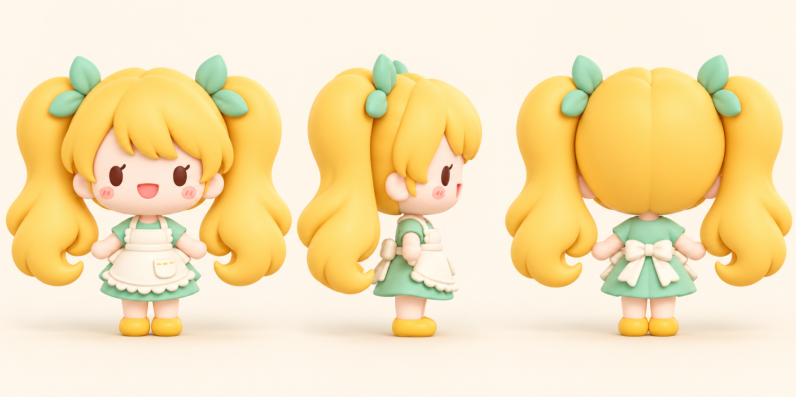

# Lunumi Mascot Style Guide

## Character at a glance

Lunumi’s mascot is a friendly, food-loving chibi character with a soft, cheerful presence. The approved reference is a stylized 3D character with an oversized head, compact body, long golden twin ponytails, and a mint-and-cream apron outfit.

## Shape and proportions

- Keep the head large and softly rounded, with a small body and short limbs.
- Hair is a defining silhouette: two broad, full ponytails with smooth, flowing curves and soft rounded ends.
- Use a few large, simple bang shapes rather than lots of narrow strands or sharp tips.
- Add two small mint leaf-shaped ties at the ponytail bases.
- Keep hands and shoes simple and rounded.

## Face and expression

- Use a pale, softly shaded face with large, dark oval eyes.
- Each eye has one small lash; both lashes face the same direction.
- Add gentle peach blush and a small open pink smile.
- Do not add a nose.
- Keep the mouth free of a dark outline.
- Aim for warm, bright, welcoming expressions. Avoid fussy facial details.

## Outfit

- Mint short-sleeve dress with a simple, gently flared skirt.
- Cream apron that clearly reads as an apron: bib, shoulder straps, waist band, front pocket, and a scalloped ruffle hem.
- Small yellow shoes that coordinate with the golden hair.
- Keep trim and stitching details tiny and sparse; the apron silhouette should stay readable at small sizes.

## Color and rendering

- Main palette: warm golden yellow hair and shoes, mint green clothing and hair ties, cream apron, peach skin and blush, deep warm brown eyes, and a coral-pink mouth.
- Render as soft, stylized 3D with rounded forms, gentle studio lighting, and smooth shading.
- Preserve clear separation between overlapping shapes (especially bangs and face, ponytails and shoulders, apron and dress) using subtle form shading and clean edges.
- Avoid heavy black outlines, hard shadows, metallic or glossy finishes, and photorealistic texture.

## Consistency rules

- Keep the same proportions, palette, hairstyle, face, and apron details across poses and views.
- Make the twin ponytails recognizable in silhouette, including in small app placements.
- For turnarounds, use matching scale and camera height for front, profile, and back views; keep the profile facing right and show the apron ties from behind.
- Do not add badge frames, café props, text, or unrelated decorations to the character artwork.

## Reference asset

The current three-view reference is [`lunumi-turntable.png`](../public/mascot/lunumi-turntable.png). Treat it as the visual source of truth when making new poses or expressions.
